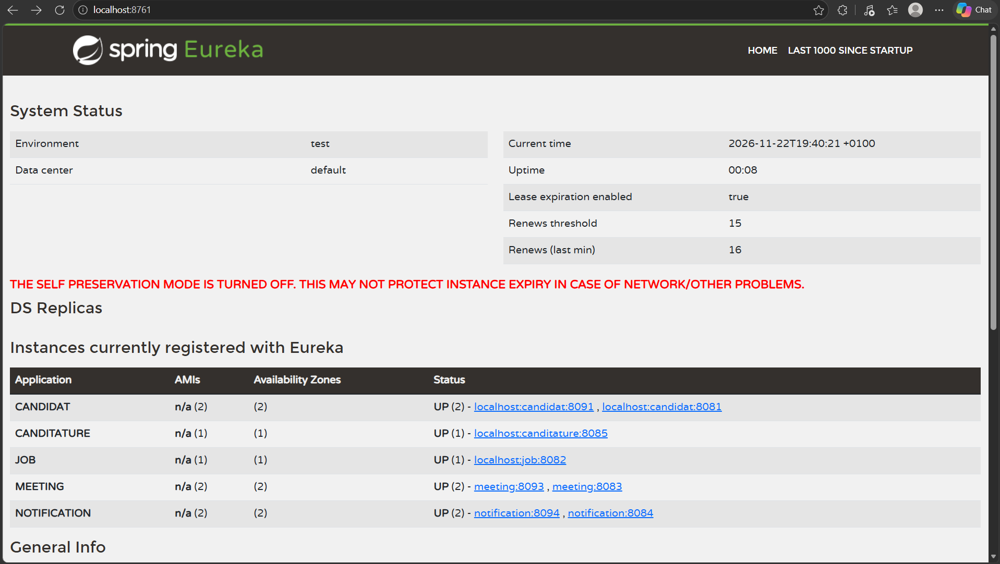

# Architecture Web Distribuée – Atelier Eureka Server

Découverte de services avec **Netflix Eureka** pour un projet de microservices (Spring Boot, Node.js, Python).
Tous les microservices s'enregistrent auprès du même serveur Eureka et se retrouvent grâce à leur nom, au lieu d'une adresse écrite en dur.

## Groupe 6 – Membres

- Taha Yassine Snoussi
- Mariem Amdouni
- Fethi Mejri
- Molka Baccari

## Architecture du projet

| Microservice | Technologie | Port | Nom dans Eureka |
|---|---|---|---|
| Eureka Server | Spring Boot | 8761 | – |
| Candidat | Spring Boot + H2 | 8081 | CANDIDAT |
| Job | Spring Boot + MySQL | 8082 | JOB |
| Candidature | Spring Boot + MySQL | 8085 | CANDIDATURE |
| Meeting | Node.js / Express | 8083 | MEETING |
| Notification | Python / FastAPI | 8084 | NOTIFICATION |

## Dashboard Eureka

Le dashboard (`http://localhost:8761`) montre tous les services enregistrés en même temps, avec plusieurs instances en cours d'exécution :

- CANDIDAT : 2 instances (8081, 8091)
- MEETING : 2 instances (8083, 8093)
- NOTIFICATION : 2 instances (8084, 8094)
- JOB et CANDIDATURE : 1 instance chacun


## Prérequis

- Java 17+ et Maven
- Node.js (LTS) et npm
- Python 3.10+ et pip
- MySQL (pour Job et Candidature)

## Lancement

Toujours démarrer le **serveur Eureka en premier**, puis les autres services.

### 1. Serveur Eureka (port 8761)

```bash
cd eureka
mvn spring-boot:run
```

Dashboard : http://localhost:8761

### 2. Services Spring Boot (Candidat, Job, Candidature)

```bash
cd candidat
mvn spring-boot:run
```

Deuxième instance de Candidat sur un autre port :

```bash
mvn spring-boot:run -Dspring-boot.run.arguments=--server.port=8091
```

Même démarche pour `job` (8082) et `candidature` (8085).

### 3. Meeting (Node.js / Express)

Installer les dépendances (une seule fois) :

```bash
cd meeting
npm install
```

Première instance (port 8083 par défaut) :

```powershell
node src/server.js
```

Deuxième instance sur un autre port, grâce à la variable d'environnement `PORT` :

**PowerShell**
```powershell
$env:PORT=8093; node src/server.js
```

**CMD**
```cmd
set PORT=8093 && node src/server.js
```

**Linux / macOS**
```bash
PORT=8093 node src/server.js
```

Test : http://localhost:8083/api/meetings/hello

### 4. Notification (Python / FastAPI)

Installer les dépendances (une seule fois) :

```bash
cd notification
python -m pip install -r requirements.txt
```

Première instance (port 8084 par défaut) :

```powershell
python -m app.main
```

Deuxième instance sur un autre port, grâce à la variable d'environnement `PORT` :

**PowerShell**
```powershell
$env:PORT=8094; python -m app.main
```

**CMD**
```cmd
set PORT=8094 && python -m app.main
```

**Linux / macOS**
```bash
PORT=8094 python -m app.main
```

Test : http://localhost:8084/api/notifications/hello

> Arrêter chaque instance avec `Ctrl+C` afin qu'elle se désenregistre proprement d'Eureka.

## Configuration Eureka

**Serveur Eureka** (`application.properties`) :

```properties
spring.application.name=eureka
server.port=8761
eureka.client.register-with-eureka=false
eureka.client.fetch-registry=false
# Développement local uniquement
eureka.server.enable-self-preservation=false
eureka.server.eviction-interval-timer-in-ms=5000
```

**Clients Spring Boot** (exemple : Candidat) :

```properties
spring.application.name=candidat
server.port=8081
eureka.client.service-url.defaultZone=http://localhost:8761/eureka
eureka.client.register-with-eureka=true
eureka.client.fetch-registry=true
eureka.instance.prefer-ip-address=true
```

**Client Node.js** : bibliothèque `eureka-js-client`, démarrée dans `src/server.js` une fois le serveur à l'écoute. Le port est lu depuis `PORT` et l'`instanceId` est `meeting:<PORT>`, ce qui rend chaque instance unique.

**Client Python** : bibliothèque `py-eureka-client`, enregistrée dans le `lifespan` de FastAPI au démarrage et arrêtée à l'arrêt de l'application. Le port est lu depuis `PORT` et l'`instance_id` est `notification:<PORT>`.

## URLs utiles

| Description | URL |
|---|---|
| Dashboard Eureka | http://localhost:8761 |
| Meeting hello | http://localhost:8083/api/meetings/hello |
| Meeting Swagger | http://localhost:8083/swagger-ui |
| Notification hello | http://localhost:8084/api/notifications/hello |
| Notification Swagger | http://localhost:8084/swagger-ui |
